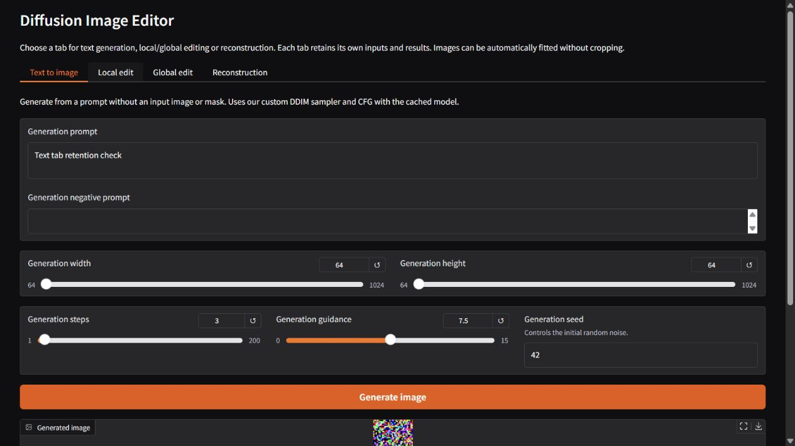

# Demo operation tabs

The main demo has four persistent tabs, replacing the visible operation radio
and separate txt2img accordion:

| Tab | Inputs and behavior | Run API |
| --- | --- | --- |
| Text to image | Generation/negative prompts, dimensions, steps, CFG and seed; no original/mask | `/txt2img` |
| Local edit | Its own original, upload/draw mask, prompts and editing controls | `/run` |
| Global edit | Its own original/prompts and editing controls; no drawing canvas | `/run_global` |
| Reconstruction | Its own original/source prompt; VAE/DDIM output choices | `/run_reconstruction` |

Switching tabs retains each tab's uploaded image, prompts, parameters, selected
outputs, results and download links. Uploading/clearing an image, changing automatic
fitting or changing output choices clears that tab's results as before. Loading the coffee example resets
only that tab and keeps its operation. A hidden operation field preserves the
existing Local edit API signature; there is no visible operation radio to change.
Legacy `/run`, `/upload_image`, `/fit_image` and associated callback names remain
available. Global/reconstruction upload, fitting and callback APIs use matching
`_global`/`_reconstruction` suffixes.

The editor form is built by one shared UI helper, with independent Gradio state
and namespaced element IDs per tab. CSS for one operation cannot hide another
tab's controls. There is exactly one paint canvas, in Local edit. It is selected
initially so the canvas can initialize at a visible size; `render_children=True`
keeps all tab children mounted across switching. Changing this initialization
policy requires another paint/switch browser check.

All tabs share one `DemoService`, offline model cache, inference lock and queue
concurrency group. Tab selection loads no weights and triggers no inference.
There is no change to generation, editing, calibration or reconstruction math.
No model dependency or checkpoint was added. Existing running demo processes must
be restarted to load the revised interface; they were not restarted automatically.

## Executed validation (2026-11-18)

`pytest tests/test_generation.py tests/test_demo.py tests/test_demo_tabs.py --run-demo -q`
completed with **43 passed, 2 skipped, 15 warnings** in 39.06 s. Warnings are the
existing Gradio/Starlette HTTP-422 deprecation. Two pretrained/GPU checks were
not enabled. Tests verify the four labels/default selection, persistent mounting,
one canvas, unique element IDs, hidden operation fields, per-tab API routing,
independent output artifacts and one shared backend load. Existing image fitting,
mask upload/drawing, output-selection, txt2img and download checks pass.

A separate in-app-browser session used a temporary loopback server with synthetic
CPU components. It visited all four tabs and completed each operation. Different
prompt markers, sampling settings, completed images and download links were
retained in their own tabs. A local stroke survived switching through all other
tabs; its brush toolbar remained present, another stroke could be added, and local
execution completed using the retained drawing. No browser console errors were
captured in the local-execution check. The temporary service was stopped after
validation; no production/research server was restarted.

The screenshot shows the Text to image controls and synthetic CPU test output,
not a real-model generation-quality example. This is an interface/lifecycle
smoke, not an acceptance rating, reconstruction/calibration gain or GPU benchmark.
