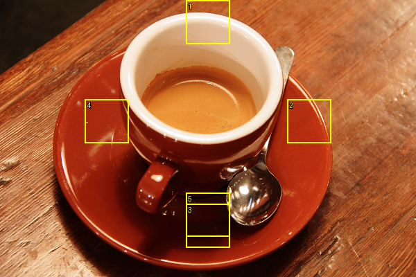
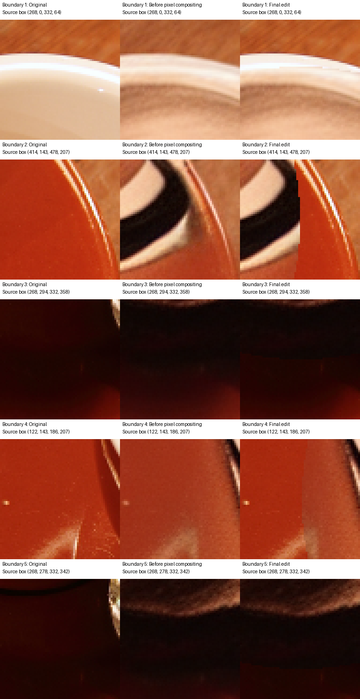

# Boundary renderer example (historical tooling smoke only)

This is **not a new acceptance case or holdout result**. It reuses the already
inspected Phase 5 coffee hard-mask output solely to demonstrate the offline review
tool. No model was run and no semantic/preservation/boundary score was assigned.
The new twelve-case registry remains assets-pending and every review row is not_run.

Sources: `assets/examples/coffee.png`, `assets/examples/coffee_mask.png`, and the
historical `outputs/editing/phase5-hard/edited.png` and `edited_uncomposited.png`.
See [input provenance](../../../assets/examples/README.md) and the
[acceptance protocol](../../acceptance.md).

Four source-mask contour anchors and an additional diagnostic center (300,310)
are shown. That extra center is a renderer demonstration on exposed historical
data, not a pre-registered new acceptance view. New-case critical centers must be
fixed before model comparisons. Crops use 64 source pixels and 4× nearest-neighbor
enlargement. All columns share the same source coordinates; images are not
smoothed or individually reframed.

The panels expose truncation/texture changes even where background compositing
preserves exterior pixels. They support the need for a separate boundary rating;
they do not establish a semantic improvement or a passing acceptance result.
Exact source boxes, zoom, dimensions and image hashes are in
[the renderer record](boundary_review.json). The [requested mask](requested_mask.png)
is included for context. No preservation metric was recomputed from these panels.
