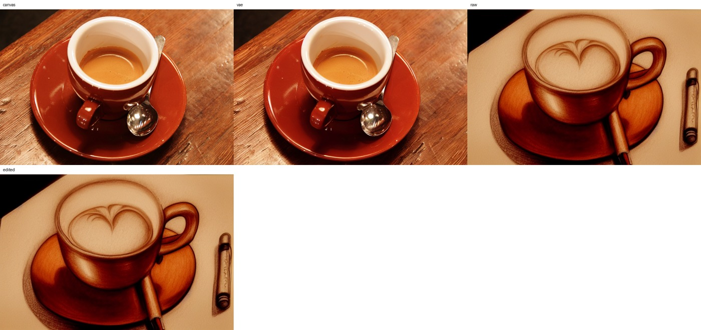
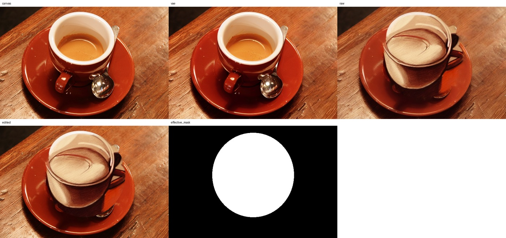
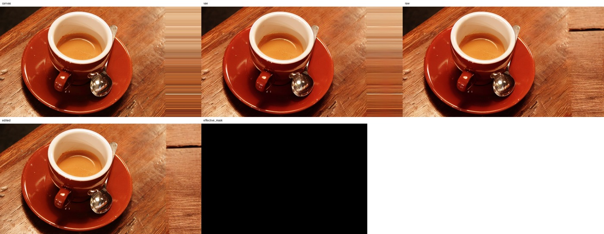
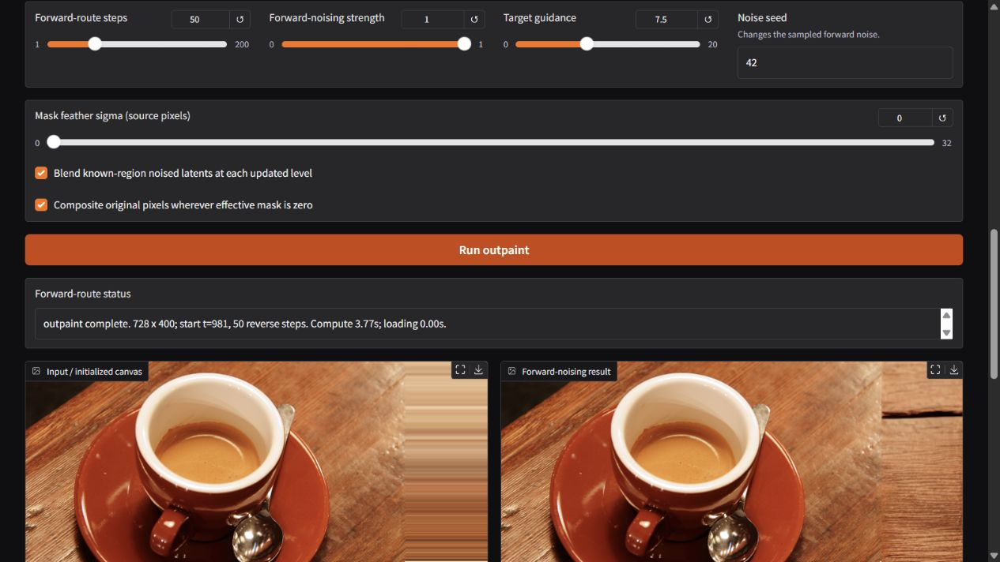

# Forward-noising implementation examples

Three real-model smokes use the existing exposed CC0
[coffee input](../../../assets/examples/README.md), cached pinned SD 1.5, seed42,
50 requested steps and guidance7.5. This is implementation evidence, **not new
holdout data or human acceptance ratings**. See [the report](../../forward-noising.md).

The [measured JSON](measured-examples.json) records prompts/settings, actual IDs,
runtime/precision, noise hashes, raw/final preservation metrics and artifact hashes.
Full local directories and archives are indexed by
`outputs/forward-editing/examples.json`. JPEG grids are resized documentation
previews; metrics were computed on original float tensors, not these previews.

## Img2Img

[Full-resolution result](img2img-result.png). Strength0.85 selects42 updates from821.
The requested style changes source detail/geometry; no source-text inversion runs.

## Inpainting

[Full-resolution result](inpaint-result.png). The original ellipse masks the edit;
raw background MAE0.04063265 becomes0 after compositing. The cup is visibly
reshaped and cut by the mask. Exact background pixels do not pass boundary quality.

## Outpainting

[Full-resolution result](outpaint-result.png). Right128 expands600×400 to728×400.
With overlap0 and feather0, source-rectangle final MAE is0. New wood-like pixels
have changed grain and a visible seam; there is no reference image for new borders.

The screenshot comes from a separate real-model browser run, using the UI's literal
default prompt. It verifies controls and result display, not superior semantic or
seam quality. Raw manual scores/review tables remain untouched.
