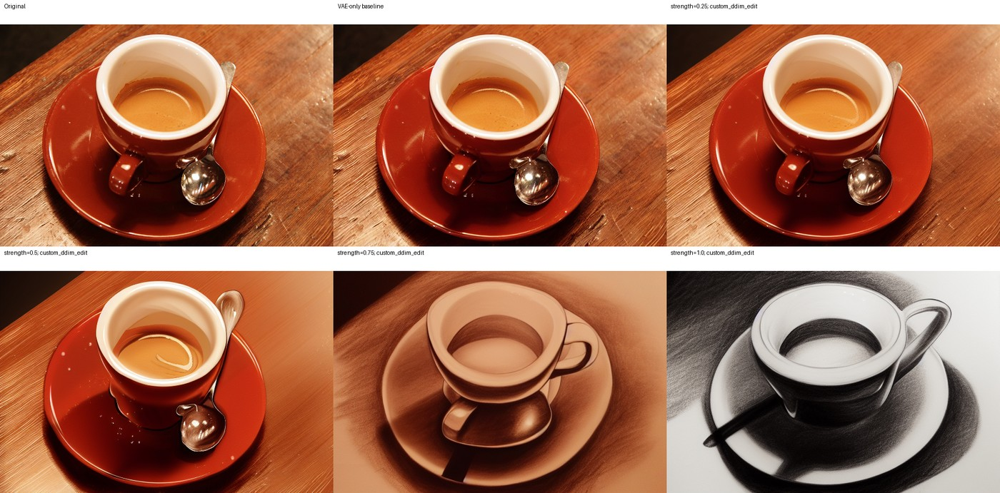
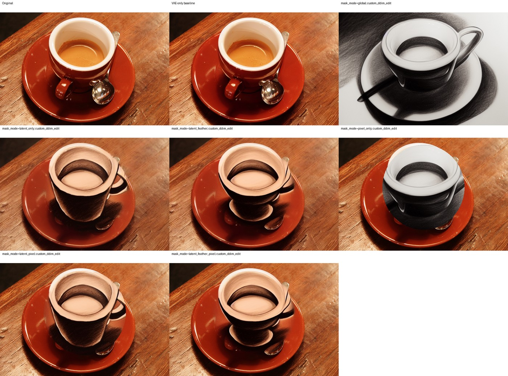
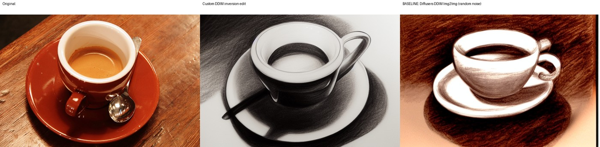
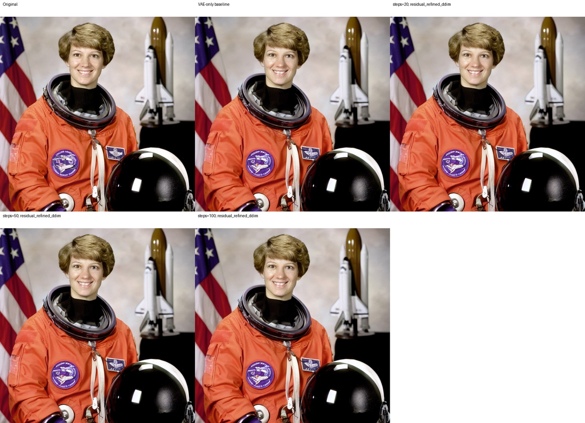

# Phase 7 measured results

This portable bundle records **34 completed custom cases and four labelled
Diffusers DDIM Img2Img baselines**. The full protocol, results and limits are in
[the Phase 7 report](../../phase7-status.md). The two public inputs and authored
mask have [recorded provenance](../../../assets/examples/README.md).

## Data

- [All custom metrics](metrics.csv): one row per completed case, including settings,
  preservation scores, runtime and actual U-Net forward/batch-element budgets.
- [Baseline comparison](baseline_comparison.csv): paired custom/baseline rows.
- [Portable measured records](measured-results.json): complete suite, input hashes,
  source-code hashes, pinned model/software/runtime and per-case results.
- [Completion summary](summary.json): all planned cases completed, none missing.

Blank table values are undefined or not applicable; exact infinite scores are
explicitly distinguished in the JSON. No metric was recomputed from these preview
images. Full-resolution PNGs, float masks and refinement diagnostics are retained
under the ignored local `outputs/experiments/phase7/` directory.

## Curves

| Study | Preview | Vector figure |
| --- | --- | --- |
| Plain reconstruction step count | [PNG](reconstruction_steps_plain.png) | [SVG](reconstruction_steps_plain.svg) |
| Refined reconstruction step count | [PNG](reconstruction_steps_refined.png) | [SVG](reconstruction_steps_refined.svg) |
| Global editing strength | [PNG](strength_global.png) | [SVG](strength_global.svg) |
| Global editing guidance | [PNG](guidance_global.png) | [SVG](guidance_global.svg) |
| Mask-operation controls | [PNG](mask_operations.png) | [SVG](mask_operations.svg) |

PSNR/SSIM measure preservation, not prompt alignment. Background MAE uses the
same requested mask across modes. Nonfinite points are omitted as labelled.
Mask presets are categorical; pairwise comparisons isolate switches as documented.
Timings include source control where applicable, exclude loading/metrics/saving,
and are descriptive. No statistical significance is claimed for two images and
one seed.

## Representative examples

These JPEG grids are resized documentation previews. Original-size PNGs and
floating-tensor metrics remain available locally. Strong edits change geometry
and identity; they are not described as faithful localized semantic successes.

The baseline and custom case share reverse timesteps, weights, seed and target
prompt; total U-Net work and latent update precision differ. Neither the higher
custom preservation score nor its monochrome output establishes equal-cost or
general semantic superiority.

Refined reconstructions remain close to their VAE baseline, with recorded residual
tolerance warnings and additional compute. Final pixel preservation in local edits
is credited to compositing, not latent blending.
