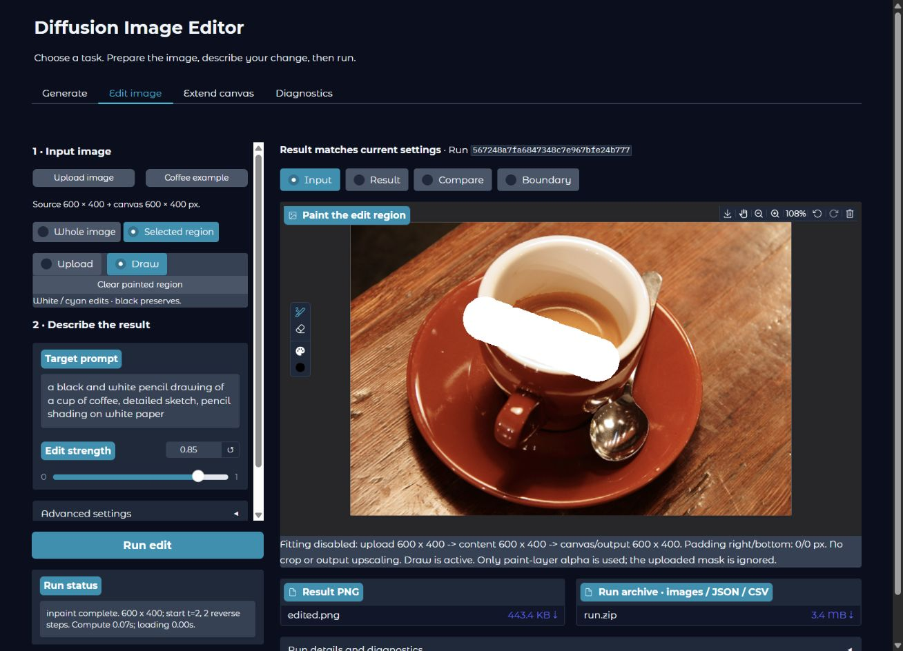
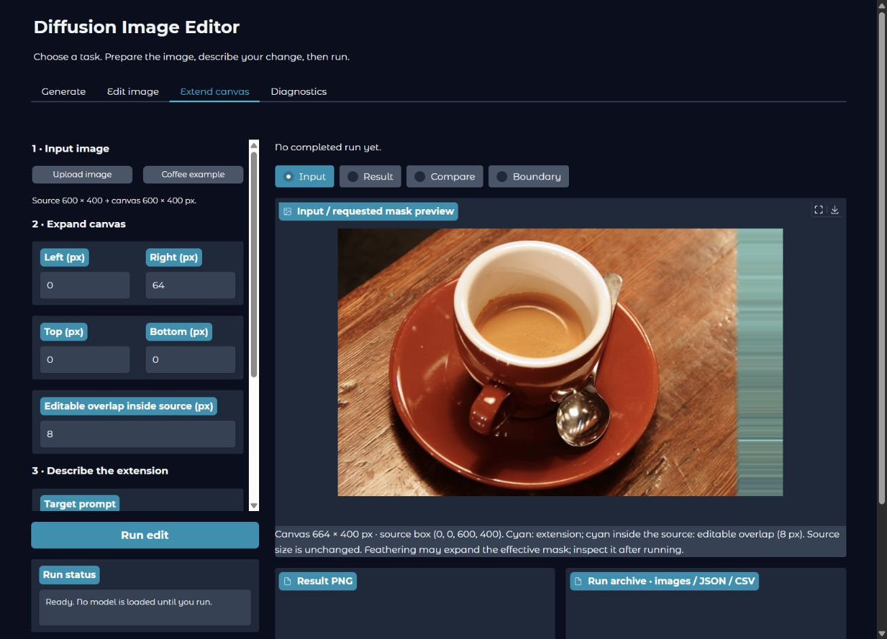
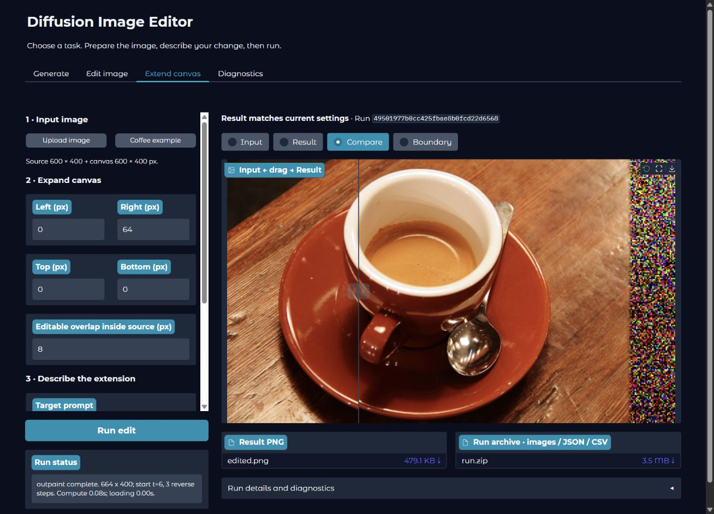
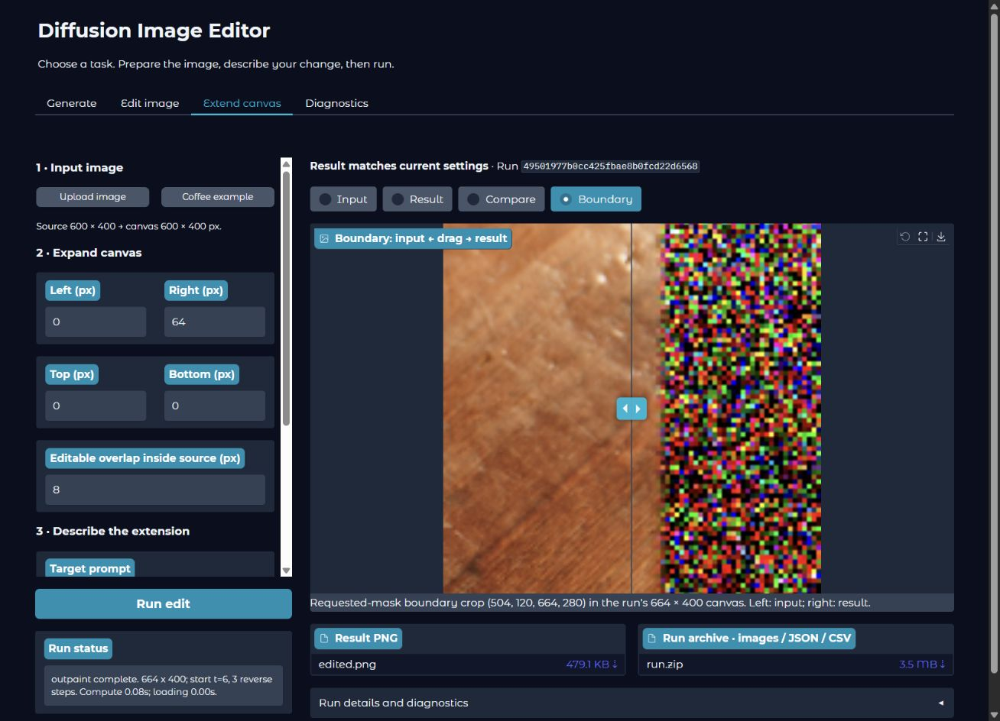

# Task-first demo workspace

The four custom SD task pages below are now accompanied by a separate **FLUX**
reference page. It shares inference serialization and navigation without changing
these task routes or their paint state. See `flux-gradio.md` for the separate
runtime, capabilities and browser verification.

The approved redesign replaces seven peer algorithm forms with four user tasks:

| Task | Basic controls | Optional / diagnostic controls |
| --- | --- | --- |
| Generate | Prompt, width, height | Steps, CFG, negative prompt, seed |
| Edit image | Image, Whole image / Selected region, active mask, target prompt, strength | Forward noising / DDIM inversion, source prompt for inversion only, steps, CFG, seed, explicit fitting, mask settings |
| Extend canvas | Image, numeric margins, editable source overlap, target prompt, strength | Steps, CFG, seed, negative prompt, fill, explicit fitting, feathering and preservation |
| Diagnostics | Image, source prompt, selected VAE / DDIM / source-control outputs | Steps, CFG, seed, fitting, residual reconstruction correction and decoded previews |

The desktop layout has a 340 px sticky settings sidebar and a flexible work area.
Settings scroll independently; Run and run status remain outside that scrolling
area. Below 800 px the columns stack, with ordinary document scrolling. This is a
Gradio-only change with no added dependency, checkpoint or sampling algorithm.

## Canvas and mask lifecycle

Edit image starts with Selected region and the existing coffee mask. Upload shows
requested weights as a cyan overlay on the source; Draw shows the initialized
ImageEditor in the same work area. The unused surface is hidden with scoped CSS,
not destroyed/recreated. Paint-layer alpha remains the only drawing-mask source;
photographic composites never become masks. Brush, eraser, undo/redo and clear
remain available. Task/view/mask-mode switching retains painting and results.

Ordinary settings/view refreshes read a lightweight paint reference rather than
exporting ImageEditor PNGs repeatedly. The reference hashes only the actual RGB
background and rounded paint-alpha union used by mask resolution; empty editor
layers, layer colors and photographic composite exports cannot create false
settings changes. A guarded `.change` handler synchronizes real painting and
discards late exports from older source canvases. `.input` alone is insufficient
after programmatic editor updates in the pinned Gradio version. This avoids
concurrent export/reset reads of temporary files while keeping paint changes
associated with the correct run.

Source dimensions and prepared dimensions appear before drawing. Fitting is
explicit and defaults off across tasks. Enabling fitting reuses the existing
aspect-preserving shrink/right-bottom edge-pad policy; original/content/canvas
geometry is displayed below the work surface. Source replacement, example reload
or fitting changes reset both masks, with a status message. Existing strict core
size and stale-background validation remain in force. Original- or prepared-size
uploaded masks follow the same existing coordinate transform.

Extend canvas previews final dimensions and source-box coordinates. Cyan marks
the requested new area and any permitted source-edge overlap; no drag-to-resize
handles are introduced. Numeric margins never silently resize the source. The
preview is model-free, checked against sampler canvas placement/weights, and
does not predict generated content. Feathering is not included in the requested
overlay; the actual effective mask is available after running.

## Results, provenance and errors

Input, Result, Compare and Boundary are views of one work area. Compare provides
a draggable input/result divider. Boundary uses a crop selected exclusively from
the requested-mask contour in the completed run's input coordinates, independent
of generated pixels. Crops are at most 160 × 160 source pixels and can be enlarged
with the image viewer. Whole-image/no-interior-boundary cases show an explicit
message rather than an invented seam. Details preserve both requested and actual
effective masks, raw decode/selected diagnostics, literal generation prompts and
the executed request. VAE/full reconstruction/source control are never calculated
merely to populate a hidden details panel.

Every successful workspace result retains its backend run ID, image/paint/settings
fingerprint and PNG hash. The ZIP gains `workspace.json`; the backend `report.json`
and existing numerical evidence are not rewritten. Explicitly fitted runs also
include `workspace_original_upload.png`. The UI report includes this association;
backend reports record the actual prepared forward request (resolved Draw weights
are passed as an aligned Upload mask) and the manifest identifies the user's mask
source/preparation separately.

Changing controls updates “Settings changed — showing previous result” while
retaining the completed images, literal prompts and downloads. Input/geometry
changes do the same while resetting masks. Completion compares the submitted
snapshot to the latest controls, so changes made during sampling cannot relabel
the previous run. Errors have a separate actionable status and preserve the last
successful output. Pixel scores remain preservation diagnostics and cannot pass
semantic acceptance.

## Compatibility and boundaries

`app.py` constructs the task workspace and retains the original seven forms in
a hidden compatibility container. `/txt2img`, `/run`, `/run_global`,
`/run_reconstruction`, `/forward_img2img`, `/forward_inpaint`, `/forward_outpaint`
and upload/fitting callbacks preserve their names and argument/result order.
These hidden adapters account for two additional compatibility paint components;
only the task editor is visible. All callbacks use the same `DemoService`, cached
backend, serialization lock and inference concurrency group. Navigation neither
loads models nor performs inference. CLI/core algorithms, reference studies,
calibration evidence and the separate human review interface are unchanged.

Existing running services must be restarted explicitly to load new source code.
Development validation uses a separate loopback port and synthetic CPU components;
it must not stop research/demo services or create real acceptance ratings.

## Validation

Focused routing/geometry/provenance tests run offline without models:

```powershell
.\.venv\Scripts\python.exe -m pytest tests/test_demo_workspace.py -q
.\.venv\Scripts\python.exe -m pytest tests/test_demo.py tests/test_generation.py tests/test_demo_tabs.py tests/test_forward_editing.py tests/test_demo_image_fit.py tests/test_demo_workspace.py --run-demo -q
```

The complete offline/HTTP suite passed **339 tests, 24 skipped**, with 19 existing
Gradio/Starlette HTTP-422 deprecation warnings in 60.17 s. All **26 focused
workspace checks** also passed after the guarded paint synchronization change.
The final focused UI/input/compatibility HTTP regression completed with
**112 passed, 3 skipped**, 19 existing deprecation warnings, in 46.30 s.
The skipped real-model/GPU checks were not enabled for this UI-only change.
Synthetic CPU outputs establish UI behavior, not pretrained-model compatibility,
semantic success, reconstruction gains or an acceptance-gate pass.

An independent in-app browser used a disposable synthetic CPU server on port
7864. It exercised all four task pages, generation, painted/whole-image editing,
the optional inversion route, VAE-only diagnostics and outpainting. It verified
paint/tools through task and scope switches, progress, rendered results/downloads,
literal executed prompts, changing settings during a run, failed-run image
retention, live margin/overlap geometry, draggable comparison and boundary crops.
An explicit 61 × 57 upload plus original-sized mask fitted to 64 × 64 and
completed with its original upload/provenance retained. Rapid fitting switches
were repeated while checking the canvas lifecycle. At the 760 px responsive
breakpoint the columns stacked and document width remained within the viewport;
the viewport override was reset afterward. No acceptance ratings were written.
The disposable server was stopped after validation; existing demo/research
services were not restarted.

Earlier browser attempts exposed a temporary-PNG read race and false dirty flags
from editor export details / suppressed `.input` after reset. Their correction
is described above and covered by the dedicated synchronization checks. Numerical
editing evidence and old research/demo services were left in place.

Screenshots below show synthetic CPU UI behavior, **not model-quality results**:





